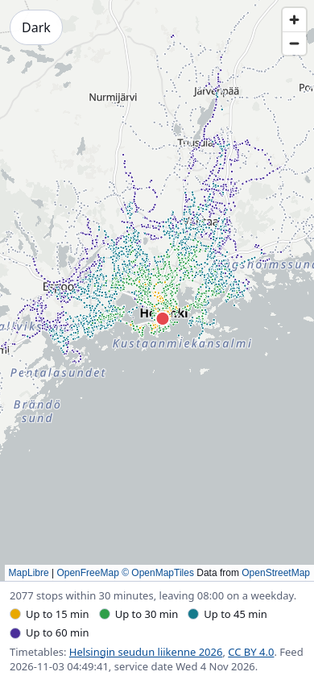
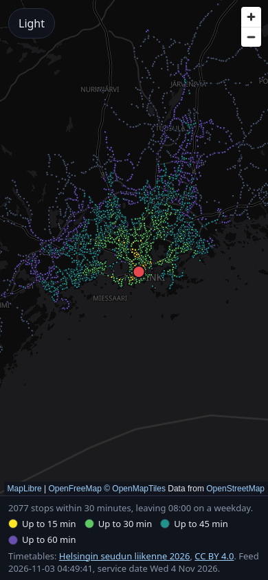
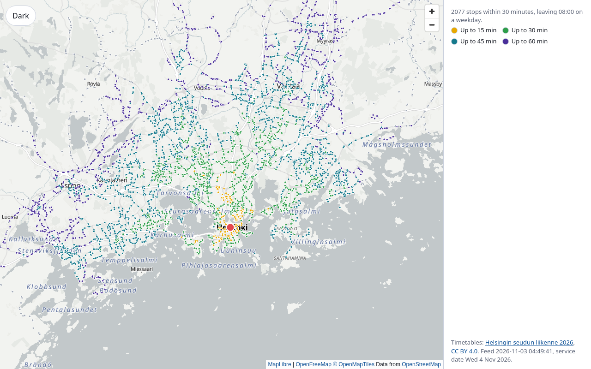
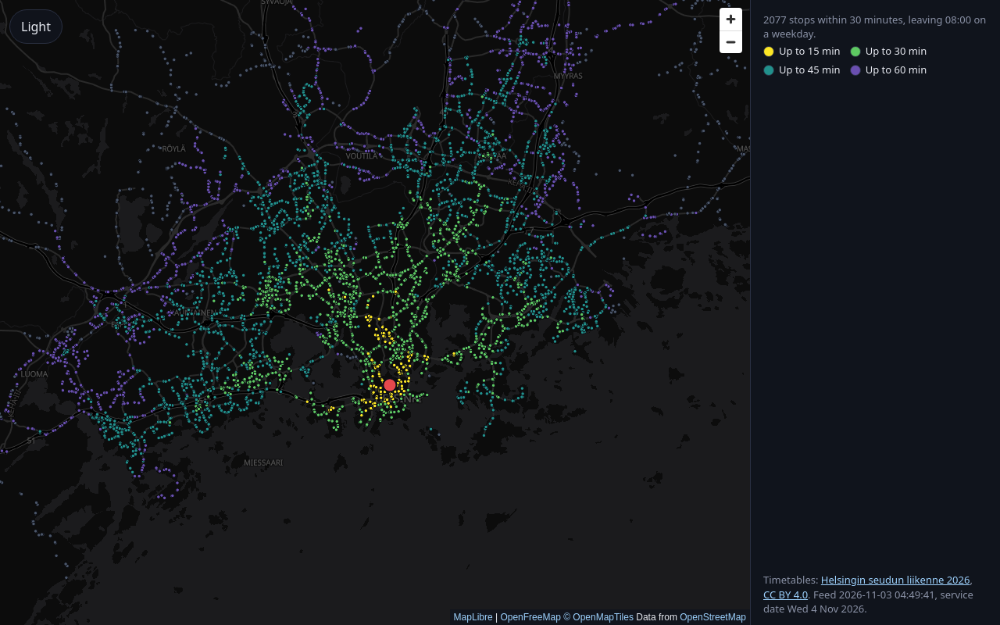

# Features

## Map

A full-viewport map of the Helsinki region from OpenFreeMap, drawn with MapLibre GL JS. It follows the system light or dark preference, and a button on the map overrides it; the choice is remembered in the browser. The attribution (MapLibre, OpenFreeMap, OpenMapTiles, OpenStreetMap) is always expanded, including on a phone.

On a desktop width the right side holds an empty panel and on a phone the bottom is reserved, for the controls later slices add.

| | Light | Dark |
|---|---|---|
| Phone |  |  |
| Desktop |  |  |

## Stops and credit

Once the weekday timetable has loaded, every boarding stop is drawn as a dot over the map; the dots follow the theme. A status line in the side panel (the bottom strip on a phone) says the timetable is loading, loaded or could not be loaded; when it fails the map stays usable. Below it a credit line names the publisher (HSL) and the feed year with a link, the CC BY 4.0 licence with a link, the feed version and the weekday service date, all read from the committed manifest.

The data comes from the committed snapshot under `public/data/`, refreshed by `bun run data:build` (see [data pipeline](research/data-pipeline.md)).

## Click to reach

Before the first click the side panel says to click the map. A click sets the origin: the search leaves 08:00 on the weekday, the traveller walks to any stop within walking range, and the search runs in the browser on the loaded timetable. Every stop is then coloured by travel time in four steps (up to 15, 30, 45 and 60 minutes) with a legend, stops beyond an hour or unreachable are grey, and the origin is marked. A one-line readout says how many stops are reachable within 30 minutes. If no stop is within walking range, a message says so and the stops return to their plain colour. The walking range and speed are the model constants in `src/core/walk.ts`.

The search also keeps, for every stop, how it was reached; `journey` in `src/core/raptor.ts` turns that into the walk and ride legs with times.

| | Light | Dark |
|---|---|---|
| Phone |  |  |
| Desktop |  |  |
