# Features

## Map

A full-viewport map of the Helsinki region from OpenFreeMap, drawn with MapLibre GL JS. It follows the system light or dark preference, and a button on the map overrides it; the choice is remembered in the browser. The attribution (MapLibre, OpenFreeMap, OpenMapTiles, OpenStreetMap) is always expanded, including on a phone.

On a desktop width the right side holds an empty panel and on a phone the bottom is reserved, for the controls later slices add.

| | Light | Dark |
|---|---|---|
| Phone | 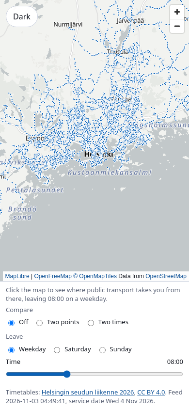 | 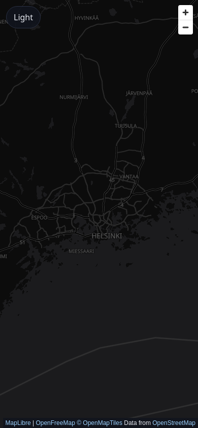 |
| Desktop | 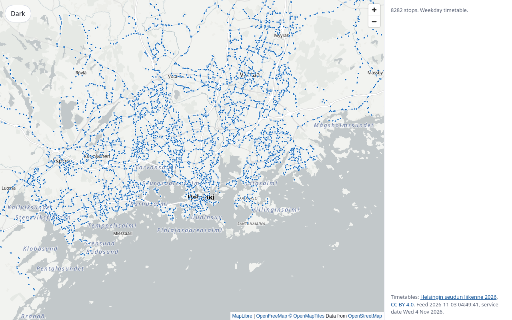 | 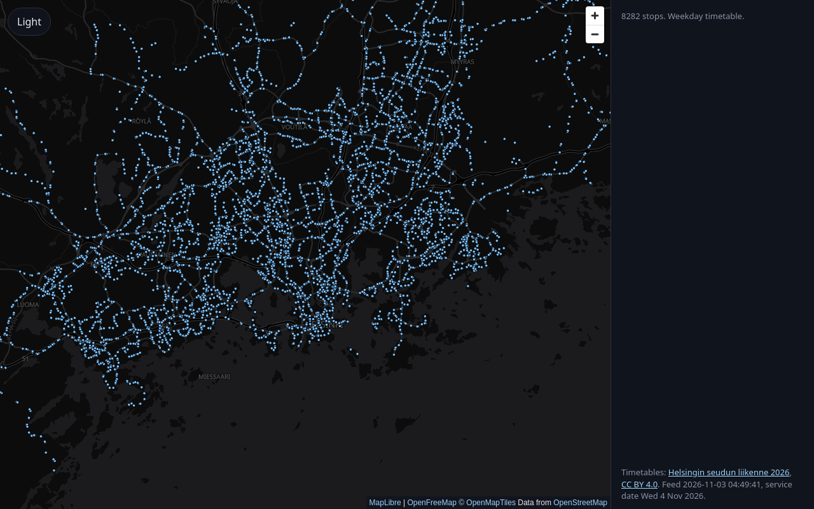 |

## Stops and credit

Once the weekday timetable has loaded, every boarding stop is drawn as a dot over the map; the dots follow the theme. A status line in the side panel (the bottom strip on a phone) says the timetable is loading, loaded or could not be loaded; when it fails the map stays usable. Below it a credit line names the publisher (HSL) and the feed year with a link, the CC BY 4.0 licence with a link, the feed version and the weekday service date, all read from the committed manifest.

The data comes from the committed snapshot under `public/data/`, refreshed by `bun run data:build` (see [data pipeline](research/data-pipeline.md)).

## Click to reach

Before the first click the side panel says to click the map. A click sets the origin: the search leaves at the chosen time, 08:00 on a weekday at first, the traveller walks to any stop within walking range, and the search runs in the browser on the loaded timetable. The origin is marked, and a one-line readout says how many stops are reachable within 30 minutes. If no stop is within walking range, a message says so and the field is cleared. The walking range and speed are the model constants in `src/core/walk.ts`.

The search also keeps, for every stop, how it was reached; `journey` in `src/core/raptor.ts` turns that into the walk and ride legs with times.

## Travel-time field

The result is drawn as a smooth colour field over the region rather than as dots. `src/core/field.ts` holds a grid over the region (the cell size is a named constant) and fills each cell with the least, over reached stops, of the stop's travel time plus the walk from the stop to the cell. Each stop writes outward only as far as the walk cap and the time it has left allow, so the work follows the number of reached stops. Cells beyond an hour or the walk cap are left empty.

`src/core/ramp.ts` turns a travel time into a colour: a sequential ramp, lighter for nearer, with its own colours for the light and dark themes, and transparent where nothing is reached. The ramp meets the legend colour at 15, 30, 45 and 60 minutes. In the browser the grid is painted into an off-screen canvas and shown as a MapLibre canvas source under the labels, so place names stay readable above the colour.

Colour is not the only carrier of the time meaning: the legend lists the four steps by name. The stop dots are hidden once a field is shown; a "Show stops" toggle in the panel brings them back, coloured by band. While a new field is computed the previous one stays and the status line says so. Clicking again moves the origin and repaints.

Near the city centre and in a suburb, with the outlines:

| | Light | Dark |
|---|---|---|
| Phone, centre |  |  |
| Desktop, centre | 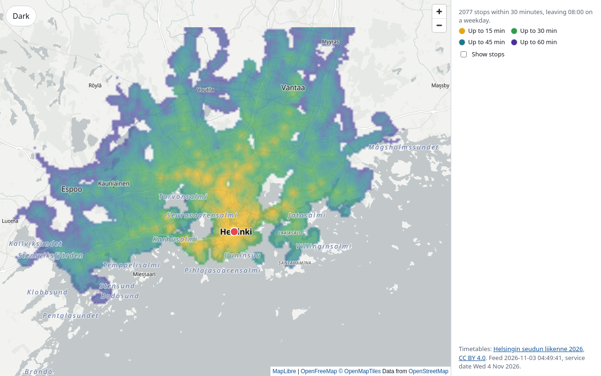 |  |
| Phone, suburb | 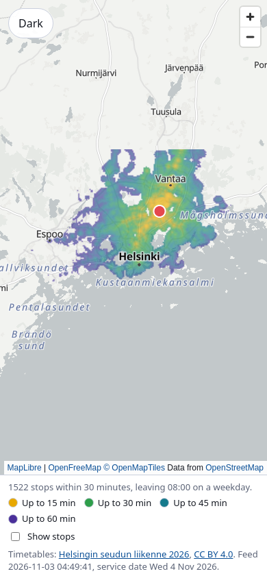 | 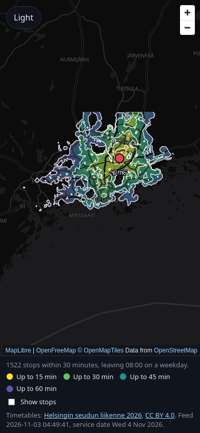 |
| Desktop, suburb | 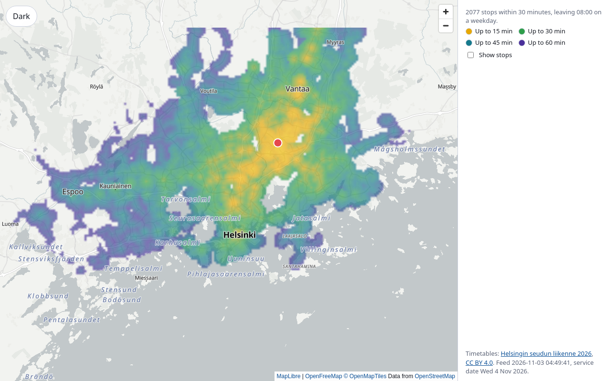 | 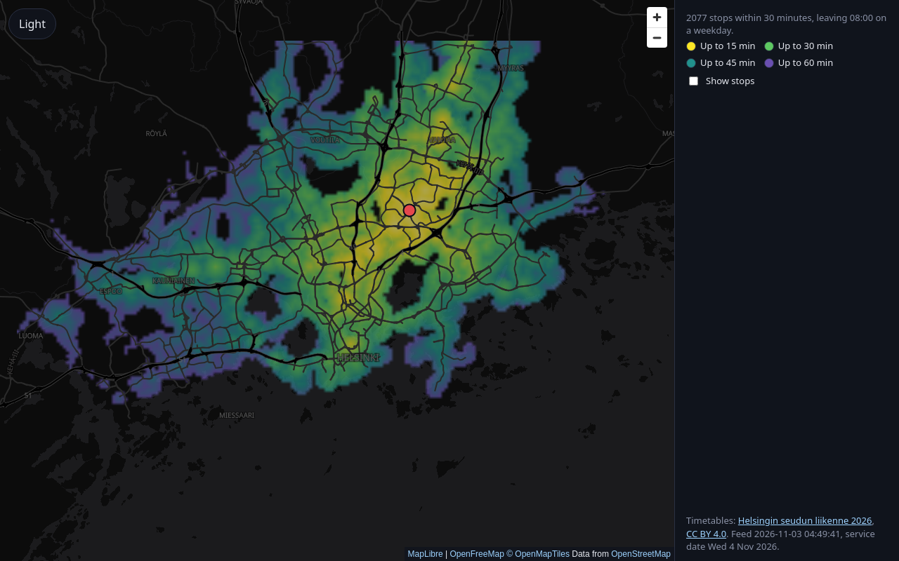 |

## Outlines

Over the field, a line marks where the travel time crosses 15, 30, 45 and 60 minutes, each labelled with its minutes along the line. `src/core/contour.ts` runs marching squares over the field grid: a vertex lies on the line between two neighbouring cell centres where the value crosses the threshold, interpolated linearly. A cell at or below the threshold is inside, an unreached cell is outside, and where a reached cell meets an unreached one the vertex sits halfway. A saddle is resolved by the mean of the four corners, so the same grid always gives the same lines. Lines that run into the edge of the grid stay open; a threshold that nothing crosses draws nothing. The lines are a GeoJSON layer drawn in a colour and halo chosen per theme.

## Departure time and day type

The panel has a day selector (weekday, Saturday, Sunday) and a time slider across the whole day in quarter-hour steps. Both are native form controls, so they work by touch and keyboard and carry labels; the slider announces the chosen time. They are enabled once the timetable has loaded. Changing either re-runs the search from the current origin and repaints the field and outlines.

`resolveServiceDay` in `src/core/service-day.ts` maps the chosen day type and clock time to the day file and the offset to search. The small hours of a morning belong to the night service of the day before: they read the previous day type with 24 hours added (a Sunday at 01:00 reads the Saturday file at 25:00). A weekday follows a weekday, since the files hold one typical weekday.

Only the selected day file is fetched until another is needed; each is fetched once and kept. While a file loads the previous result stays and the status line says so; if it fails, the status line says so, the selector goes back to the day shown and the old result stays.

The same origin at 08:00 on a weekday and at 23:00 on a Sunday:

| | Light | Dark |
|---|---|---|
| Desktop, weekday 08:00 | 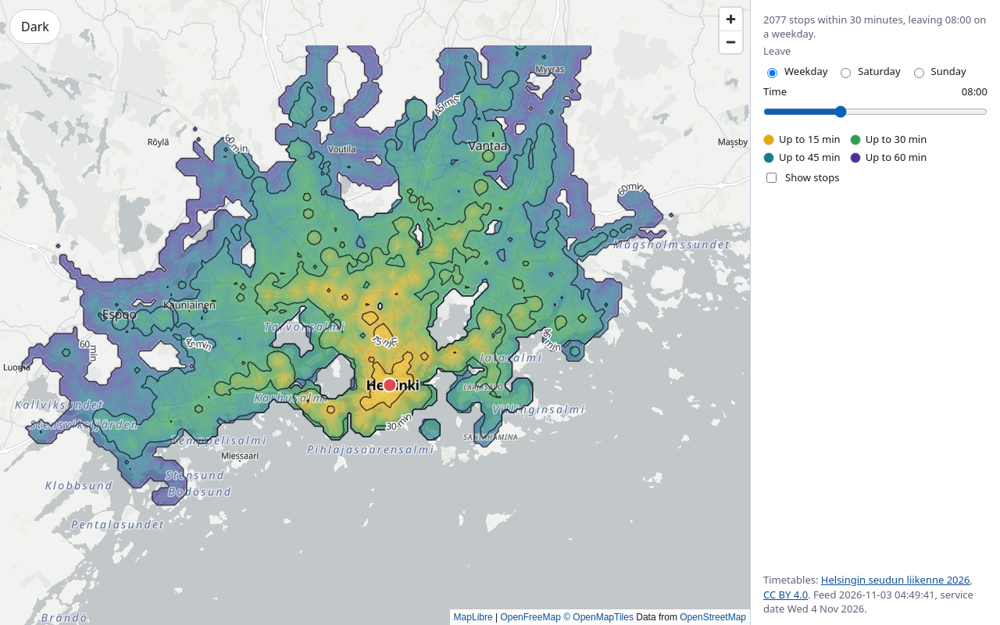 | 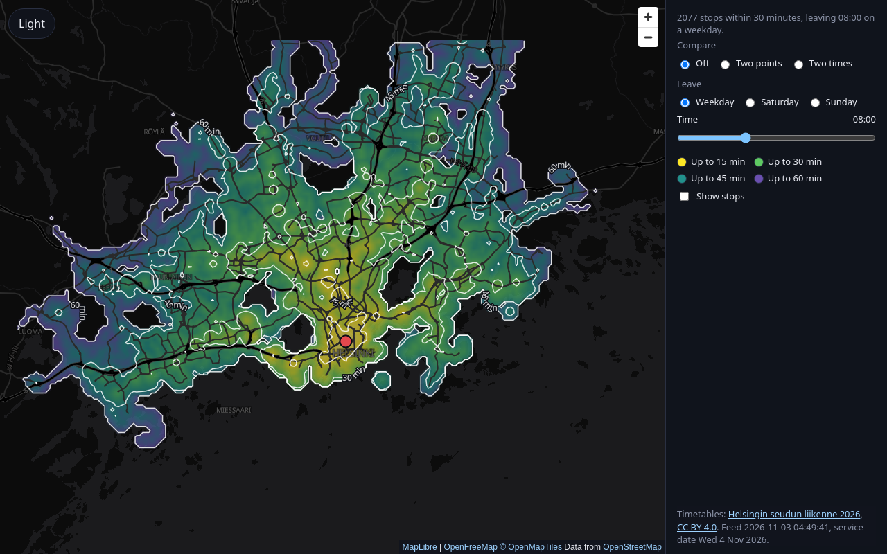 |
| Desktop, Sunday 23:00 | 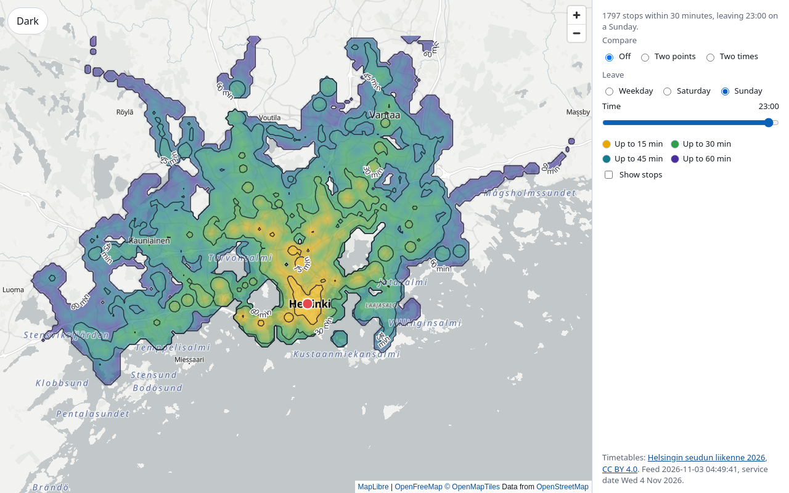 | 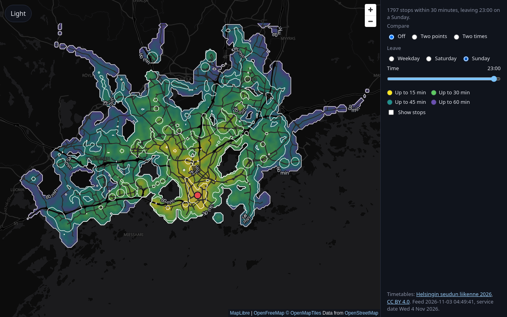 |
| Phone, weekday 08:00 | 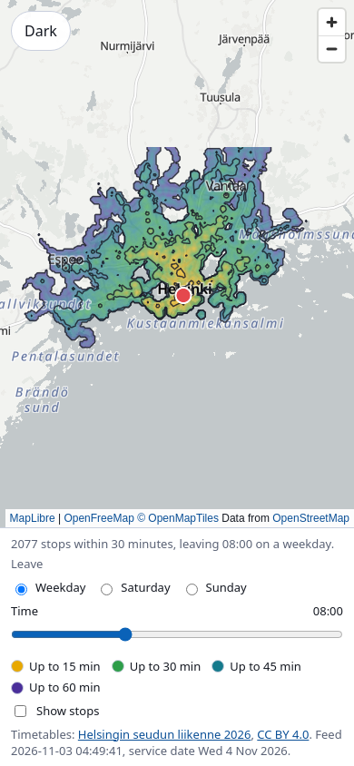 | 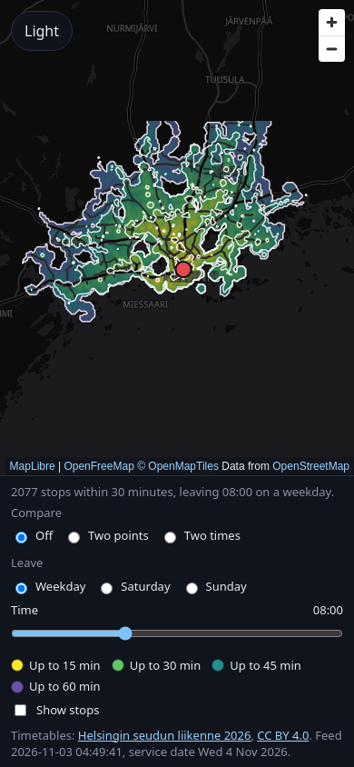 |
| Phone, Sunday 23:00 | 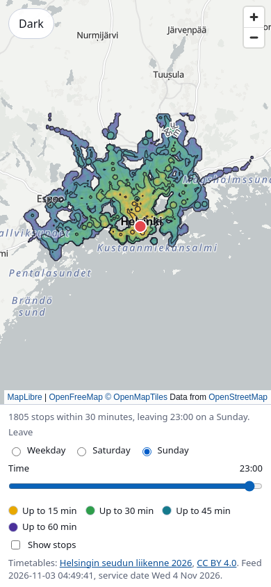 | 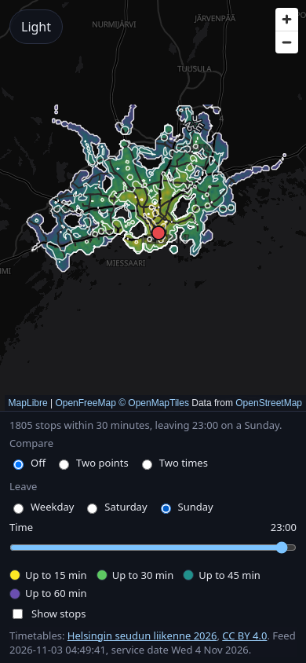 |

## Fastest journey on hover

With an origin set, moving the pointer over the map shows how to get to that point fastest, and draws it. The best stop for the point is the one with the least arrival plus the walk from the stop to the point, within the walking cap and the hour the field covers; the journey is read from the result of the last click, so hovering never searches again. On touch, pressing and dragging does the same while the finger is down.

`describe` in `src/core/describe.ts` turns the legs into a short account: the walking minutes (to the first stop, between stops and from the last stop), each ride with its line label, mode and boarding and alighting stop names, the number of changes and the total time. The panel shows that account; the path is straight segments between the stops of each leg (ADR 0004), coloured by mode with walking in a neutral colour. A point nothing reaches shows no panel and no path, as does a point before there is an origin.

| | Light | Dark |
|---|---|---|
| Desktop | 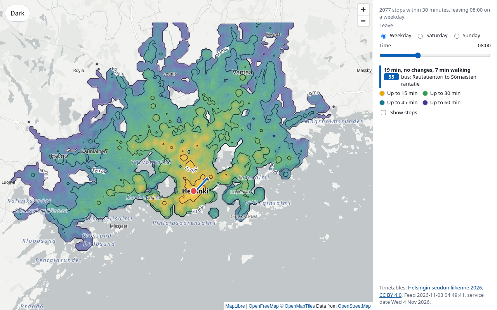 | 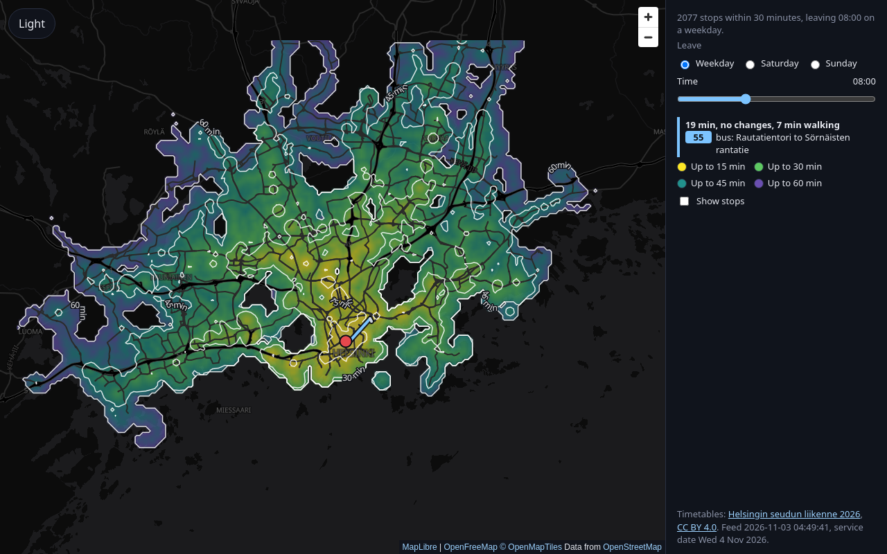 |
| Phone | 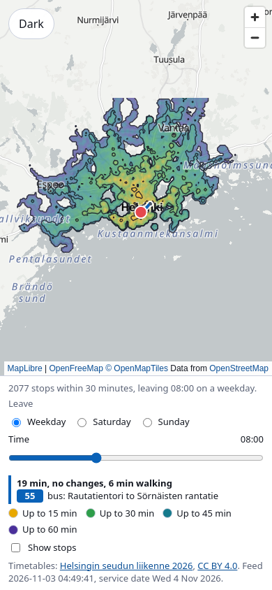 | 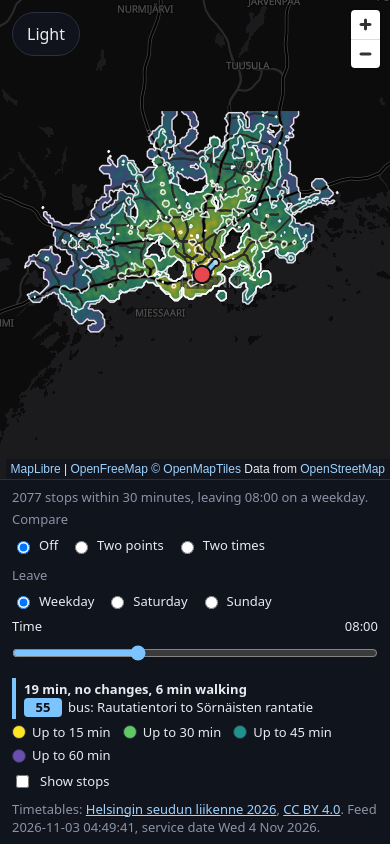 |

## Comparison mode

A "Compare" switch in the panel sets one of three modes: off, two points at the same time, or one point at two times. Turning it off, or changing mode, starts the comparison over and returns to the single view.

- Two points: the first click sets the first point; a "A click sets" choice then moves to the second point, and a click sets whichever is selected. Both points leave at the time set in the main controls. Until the second point exists, the first point's field stays on screen with a hint.
- Two times: with a point chosen, a second day and time selector appears. Until it is touched, a hint asks for it; after that the same point is searched at both times.

`diffFields` in `src/core/diff.ts` compares two fields cell by cell. A cell is reached by both fields, by only the first, by only the second, or by neither; a time difference exists only where both reach the cell, so a cell reached on one side is never given a made-up difference. `readout` turns the counts of cells within 30 minutes into one sentence, and `isFlat` says when nothing differs, which the panel reports as no difference.

`src/core/diff-ramp.ts` colours the difference. It is diverging: blue where the second is quicker, orange where it is slower, a neutral at zero, and a stronger shade for a cell only one side reaches. Blue and orange stay apart for the common colour vision deficiencies, and each side gets steadily darker (light theme) or lighter (dark theme) the further it is from zero. The legend names every colour. The outlines of the first situation stay solid and labelled; those of the second are dashed. The hover journey is off while comparing.

| | Light | Dark |
|---|---|---|
| Desktop, two points | 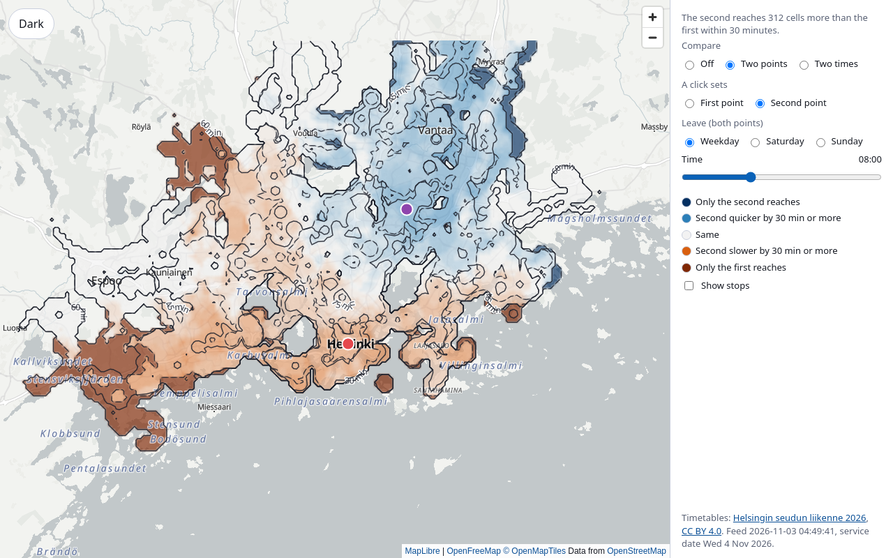 | 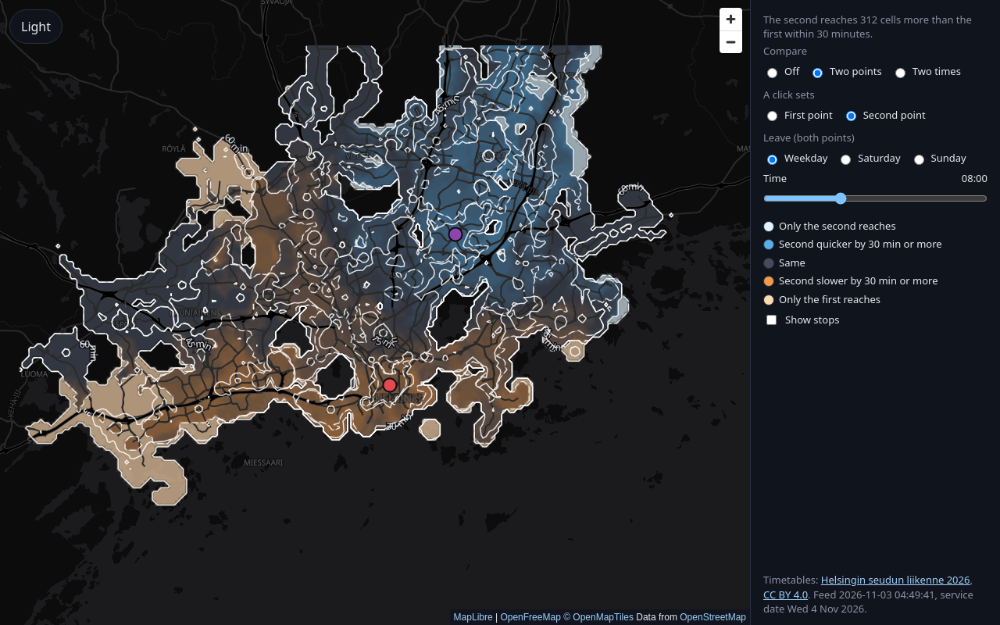 |
| Phone, two points | 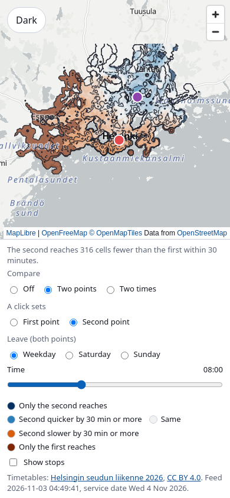 | 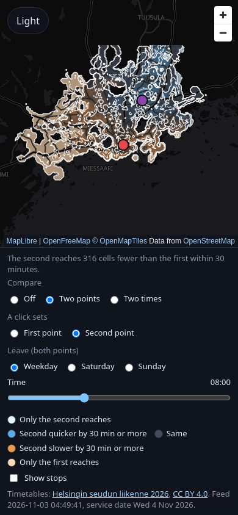 |
| Desktop, weekday 08:00 against Sunday 23:00 | 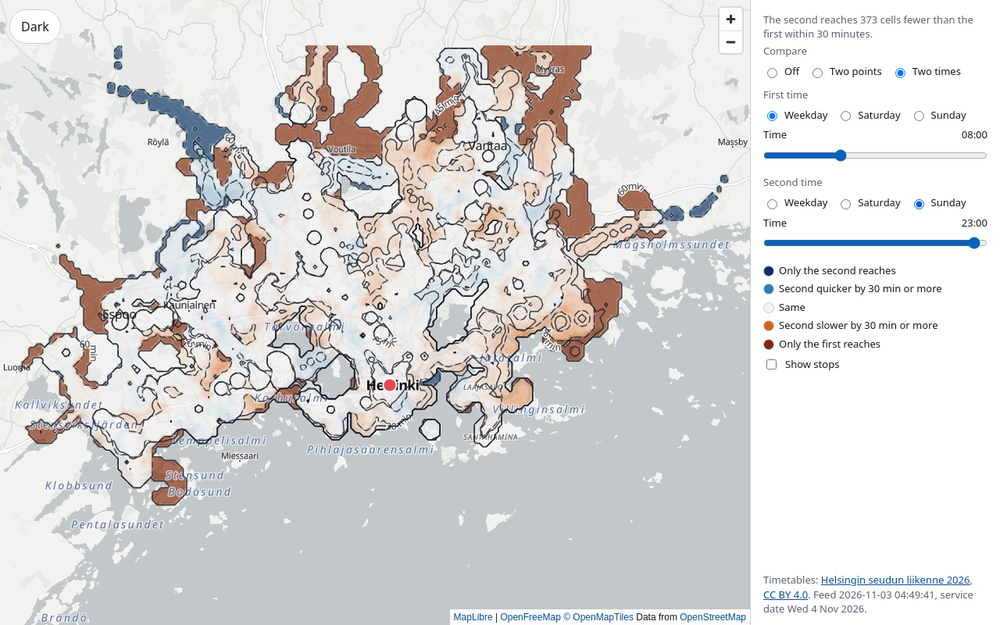 | 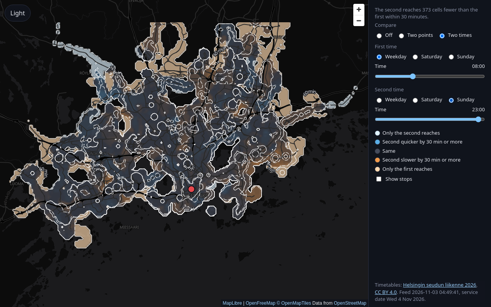 |
| Phone, weekday 08:00 against Sunday 23:00 | 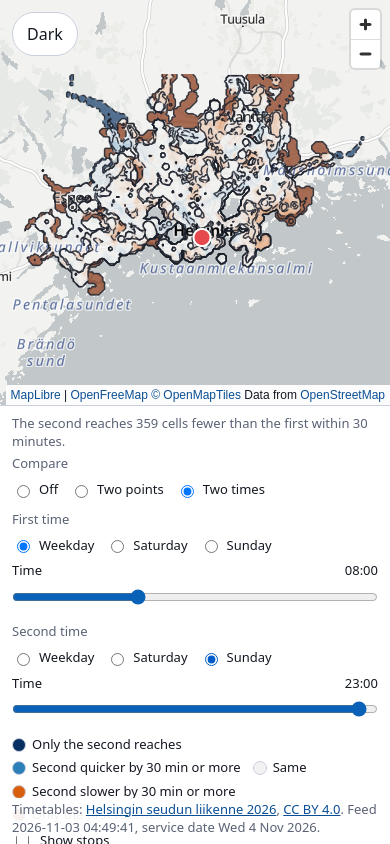 | 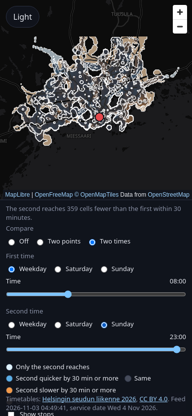 |
