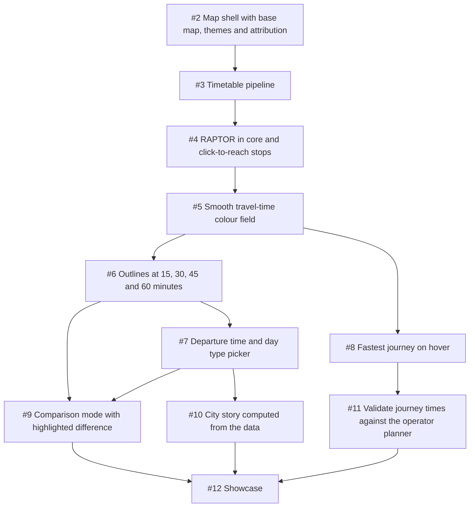

# Build plan

The build as ordered vertical slices. Each slice ends in something the owner can see in a screenshot, names its acceptance in its issue, and keeps maths and data logic in pure, tested modules in `src/core` apart from rendering in `src/ui` and input and output in `src/shell` ([ADR 0007](adr/0007-layers.md)). The decisions behind the slices are the ADRs in [adr/](adr/) and the notes in [research/](research/).

Read top to bottom: an arrow means the later slice needs the earlier one. The engine picks the highest priority ticket whose blockers are closed.

## Slices

### 1. Map shell with base map, themes and attribution (#2)

- Priority P1, effort medium, blocked by: none
- Visible result: A real map of Helsinki in light and dark, on a phone and a laptop, with attribution.
- Acceptance: see the issue.

### 2. Timetable pipeline: GTFS to compact day files, stops on the map (#3)

- Priority P1, effort large, blocked by: #2
- Visible result: Every stop drawn over the map and the credit line with the feed version and date.
- Acceptance: see the issue.

### 3. RAPTOR in core and click-to-reach stops (#4)

- Priority P1, effort medium, blocked by: #3
- Visible result: Click the map and the stops recolour by travel time, with a count of stops reachable in 30 minutes.
- Acceptance: see the issue.

### 4. Smooth travel-time colour field (#5)

- Priority P1, effort medium, blocked by: #4
- Visible result: A smooth colour field of travel time from the clicked point, with a legend.
- Acceptance: see the issue.

### 5. Outlines at 15, 30, 45 and 60 minutes (#6)

- Priority P2, effort small, blocked by: #5
- Visible result: Labelled outlines at 15, 30, 45 and 60 minutes on top of the field.
- Acceptance: see the issue.

### 6. Departure time and day type picker (#7)

- Priority P2, effort medium, blocked by: #6
- Visible result: A day type and time control; the same origin looks different at 08:00 on a weekday and 23:00 on a Sunday.
- Acceptance: see the issue.

### 7. Fastest journey on hover (#8)

- Priority P2, effort medium, blocked by: #5
- Visible result: Hovering shows the fastest journey: walk, lines, changes, total, and the path on the map.
- Acceptance: see the issue.

### 8. Comparison mode with highlighted difference (#9)

- Priority P2, effort medium, blocked by: #6, #7
- Visible result: Two points or two times side by side, with the difference highlighted.
- Acceptance: see the issue.

### 9. City story computed from the data (#10)

- Priority P2, effort medium, blocked by: #7
- Visible result: A paragraph about the city computed from the data.
- Acceptance: see the issue.

### 10. Validate journey times against the operator planner (#11)

- Priority P2, effort medium, blocked by: #8
- Visible result: A table of sample trips with our time, the operator planner time, the date checked and the difference.
- Acceptance: see the issue.

### 11. Showcase: README with screenshots and the city story (#12)

- Priority P3, effort small, blocked by: #9, #10, #11
- Visible result: The README opens with the screenshots and the story.
- Acceptance: see the issue.

## Rules for every slice

- Pure logic (routing, walking, field, contours, differences, journeys, story) lives in `src/core` with tests on small hand-built fixtures; nothing in core reads files, the network or the DOM.
- Tests never touch the network. The committed snapshot under `public/data/` is read by tests from disk.
- Every slice with a screen ships screenshots from the project's screenshot command in light and dark, on the phone and desktop viewports.
- Docs change in the same PR as the behaviour. `docs/features.md` grows one section per visible feature.
- Credit lines for the HSL feed and for the map stay visible on the phone viewport.

## Known risks

- Walking across water: the straight-line model reaches across bays; the validation slice measures it and a land mask may become a follow-up.
- The public OpenFreeMap instance has no service promise; a self-hosted PMTiles extract is the fallback ([ADR 0005](adr/0005-base-map-and-drawing.md)).
- The operator planner cannot be read by a plain fetch; the validation slice declines rather than guessing if a scripted browser also fails ([validation](research/validation.md)).
