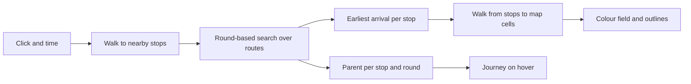

# Routing

How to find the earliest arrival at every stop from a point and a time, and the journey behind each arrival.

## The question the page asks

A click asks a one-to-all question: leaving here at this time, when is each stop first reachable? The map then adds the walk from each stop to each pixel. Hover asks for one path. Comparison asks the question twice. The query must come back in well under a second in the browser.

Read left to right: the search produces arrival times and parents; the field and the hover journey are both derived from them.

## Options

| Algorithm | Idea | Walking transfers | One-to-all | Notes |
|---|---|---|---|---|
| RAPTOR | Round k finds the best arrivals using k vehicle legs, scanning each route once per round ([Delling, Pajor, Werneck, Round-Based Public Transit Routing](https://www.microsoft.com/en-us/research/publication/round-based-public-transit-routing/), Transportation Science 2015) | A footpath relaxation after each round | Natural: with no target the rounds run to a bound | Simple arrays, no precomputed index, a good fit for a browser. Includes rRAPTOR for a departure window and McRAPTOR for several criteria. |
| Connection Scan | Scan all connections sorted by departure time once ([Dibbelt, Pajor, Strasser, Wagner, Connection Scan Algorithm](https://arxiv.org/abs/1703.05997)) | Needs footpaths closed under transitivity or handled with extra care | Natural | Very fast and simple, but it scans every connection of the day for each query and gives the fewest-changes answer less directly. |
| Trip-Based | Precomputed transfers between trips ([Witt, Trip-Based Public Transit Routing Using Condensed Search Trees](https://arxiv.org/abs/1607.01299)) | Handled in preprocessing | Supported | Faster queries, but a heavy preprocessing step and data file for a gain the page does not need. |
| Transfer Patterns | Precomputed optimal transfer sequences between stops | In preprocessing | Poor fit | Built for continental-scale planners behind a server. |

## How RAPTOR treats walking and the departure window

- Walking between stops is a list of stop-to-stop footpaths (see [walking-access](walking-access.md)). After each round's route scan, every stop improved in that round relaxes its footpaths once. Footpaths are not chained, which matches GTFS transfer semantics.
- The traveller's own first walk is handled by seeding every stop within walking range with an arrival equal to the departure time plus the walk.
- A departure window (best case over, say, 8:00 to 9:00) is rRAPTOR: run departures latest first and keep labels between runs. The brief asks only for a chosen time, so the first build does a single run, and the window stays an option.
- Routes in RAPTOR must be free of overtaking: trips of one route are ordered the same at every stop. The pipeline groups trips by stop sequence and starts a new route when a trip would overtake another.
- Times may pass 24:00:00 in GTFS. Queries are expressed in seconds from the start of a service day, and a query in the small hours uses the previous service day shifted by 24 hours.

## Recommendation

RAPTOR, single criterion plus rounds, with per-round parents kept for journey reconstruction. See [ADR 0002](../adr/0002-routing-algorithm.md).

## Check of the riskiest assumption

The search lives in `src/core/raptor.ts` and is tested against a hand-built timetable whose earliest arrivals and journeys were worked out on paper (`src/core/raptor.test.ts`; the walk from F to E beating the second line is one of the worked cases). A second test (`src/core/raptor-snapshot.test.ts`) runs a query on the committed weekday file and asserts it finishes in under a second.

Result: a one-to-all query from a central Helsinki point, six rounds, on a weekday morning takes a few milliseconds, and decoding the processed day takes roughly a tenth of a second. That is two orders of magnitude inside the budget, which leaves room for the walk-to-cell field, journey reconstruction and slower phones. The permanent test above is the check that keeps it so.
