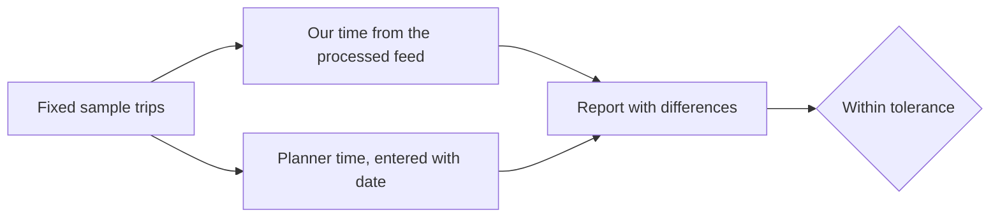

# Validation

How the page's journey times are checked against the operator's journey planner.

## What can be automated and what cannot

The operator's planner is the Digitransit service behind the HSL journey planner. Its [routing API](https://digitransit.fi/en/developers/apis/1-routing-api/) refuses requests without a subscription key (checked on 2026-11-03: HTTP 401, "missing subscription key"), and the planner website answers automated fetches with a bot challenge. The brief rules out keys for the app; a one-off comparison is not the app, but obtaining a key is a human step. So the planner lookups are recorded by hand, or by a scripted browser if the site allows one, and the repository holds the record, not a live dependency.

## Method

Read left to right: the list never changes between runs; only the two columns of times and the date are filled in.

- **Sample trips.** About a dozen fixed origin-destination pairs with a departure time and day type, covering: a metro trip, a tram trip, a commuter rail trip, a bus-only trip, a trip with one change, a trip with two changes, a ferry trip, a Sunday late evening trip, and a suburb-to-suburb trip. Coordinates are stop locations so walking at either end is short.
- **Our time.** A command prints door-to-door time for each trip from the processed snapshot.
- **Operator time.** Recorded as the planner's fastest itinerary for the same departure, with the date it was checked, the feed version of the snapshot, and the planner address used. The record is a file in the repository, so a reviewer can see when it was last checked.
- **Tolerance.** The brief asks for agreement within a few minutes. The report states the tolerance (start at five minutes) and lists each trip's difference, never only a pass count. Systematic overestimates point at the walking model; mixed errors point at the data.
- **When the planner and the snapshot disagree on dates.** The planner reflects today's feed; the snapshot reflects the day it was taken. The check is only meaningful when both describe the same service, so the record stores both feed versions and the report refuses to compare across a gap larger than a few weeks.

## Recommendation

Fixed trip list in the repository, a command that prints our times and compares them with recorded operator times, tolerance stated, dates recorded. The walking factor from [walking-access](walking-access.md) is tuned here, once, against this list. See [ADR 0006](../adr/0006-validation.md).
