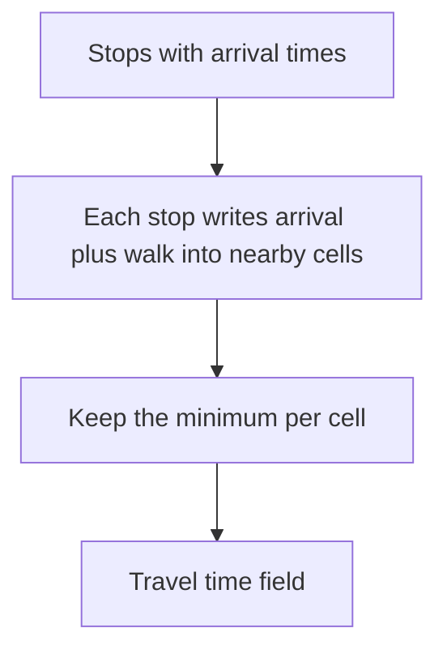

# Walking access

How long it takes to walk to a stop, between stops, and from the last stop to the place under the cursor.

## Options

| Option | How | Accuracy | Cost |
|---|---|---|---|
| Straight line with a detour factor | Distance as the crow flies, multiplied by a constant, divided by a walking speed | Wrong where the street network is far from straight: across water, rail yards, parks with no paths. Fine in a grid of streets. | Tiny: a few constants and a spatial index. No extra data. |
| Street network from OpenStreetMap | Extract the pedestrian graph from an [OpenStreetMap extract](https://download.geofabrik.de/europe/finland.html) and run shortest paths from each stop | Matches what journey planners do | A national extract is hundreds of megabytes before clipping; needs a PBF reader, a graph builder and per-stop searches in the pipeline; the licence is [ODbL](https://opendatacommons.org/licenses/odbl/1-0/) with attribution. |
| Hybrid | Street-network walking only for stop-to-stop transfers, computed offline and shipped inside the timetable; straight line for the first and last stretch | Good where it matters most, transfers | Pipeline complexity of the second option, but nothing heavy in the browser. |

## What the browser needs

Two walks. Stop to stop (transfers) is a sparse list that the pipeline can precompute either way. Stop to map cell is dense: every cell near every reached stop. That one has to be cheap in the browser, which means a model computed from coordinates, not from a graph the page would have to load.

Read top to bottom: each reached stop spreads outward only as far as the remaining time allows, so work is proportional to reached stops times cells in a small disc.

## The water problem

Helsinki is on a coast with bays. A straight line crosses water that no pedestrian crosses. Two limits keep this honest: a maximum walking distance per leg, and a land mask in a later slice if the colour field visibly spills over the sea.

## Recommendation

Straight line with a detour factor and a fixed walking speed, kept behind one small interface so the model can change without touching the router. The factor and speed start as assumptions to be calibrated by the validation slice ([validation](validation.md)), not as measured truths. A street-network transfer list stays the upgrade path if validation shows transfers are mis-timed. See [ADR 0003](../adr/0003-walking-access.md).

## How the field uses the walk model

The colour field ([features](../features.md)) is the dense walk from the diagram above. Each reached stop writes `arrival + walkSeconds(distance)` into the cells whose centres lie within the field walk cap (`MAX_FIELD_WALK_METRES` in `src/core/walk.ts`), and each cell keeps the minimum. The time a stop has left bounds the disc it paints, so a stop reached late paints a smaller area. The same detour factor and speed as for transfers apply, so one change to the model moves the whole field. The water problem remains: a cell across a bay from a stop is painted if it is inside the cap, and the cap is what limits the spill until a land mask exists.
